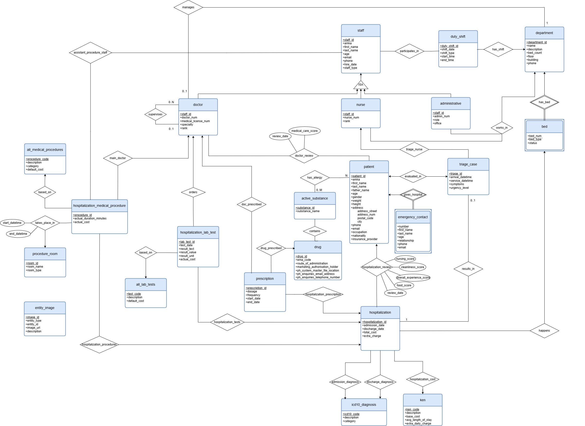

# Hospital Database

A PostgreSQL database for a hospital information system: schema, seed data and loader.


<sub>Authors · [Apostolos Stefanos Tzellas](https://github.com/tzellas) · [Nikos Liagkas](https://github.com/NikosLiagkas)</sub>

## What it does

Stores the core records of a hospital: patients and their emergency contacts, staff and duty rosters, emergency triage, hospitalizations, procedures, lab tests, prescriptions and patient reviews.

The schema also enforces a set of rules in the database itself, with constraints and triggers, so they hold no matter which application writes the data. For example:

- a drug containing a substance the patient is allergic to cannot be prescribed
- a bed or a procedure room cannot be booked twice for the same time
- every shift has at least 3 doctors, 6 nurses and 2 administrative staff
- monthly shift limits per role, and at least 8 hours of rest between shifts
- reviews can only be written after the patient has been discharged

## Data

About 250,000 rows in total. Medicines, diagnosis codes and the procedure list come from public sources; people and clinical activity are synthetic.

| Data | Records | Source |
|---|---|---|
| Medicines | 5,269 drugs · 1,638 active substances | European Medicines Agency register, products authorised in Greece |
| Diagnoses | 11,008 codes | ICD-10 |
| Inpatient cost categories | 701 | KEN, the Greek DRG-style system |
| Procedures and lab tests | 6,428 · 4,030 | Official list of medical actions (prices are synthetic) |
| Patients and staff | 300 patients · 929 staff | Synthetic |
| Hospital structure | 15 departments · 618 beds · 50 procedure rooms | Synthetic |
| Hospitalizations and triage | 1,850 · 2,550 | Synthetic, generated by seeded scripts |
| Prescriptions, labs, procedures, reviews | 1,550 · 1,150 · 750 · 3,121 | Synthetic, generated by seeded scripts |
| Duty shifts | 16,425 shifts · 180,675 staff assignments | Synthetic, generated by seeded scripts |

All patient and staff records are synthetic; they do not describe real people. ICD-10 and KEN descriptions are in Greek. The generators are seeded, so running them again reproduces the CSVs in `data/` exactly.

## Schema

<p align="center">
  
</p>

<p align="center"><sub>
  <a href="docs/diagrams/er-diagram.pdf">ER diagram (PDF)</a> ·
  <a href="docs/diagrams/relational-schema.png">Relational schema</a>
</sub></p>

## Run it

Run everything from the repository root, as a PostgreSQL superuser such as `postgres`. `load.sql` uses client-side `\copy`, so it needs `psql`.

```bash
createdb -U postgres hospital
psql -U postgres -d hospital -f sql/schema.sql    # tables, constraints, indexes, triggers
psql -U postgres -d hospital -f sql/load.sql      # loads the CSVs, then checks the result
psql -U postgres -d hospital -f sql/queries/01_hospital_revenue.sql
```

No local PostgreSQL? Use Docker:

```bash
docker run -d --name hospital-db -e POSTGRES_PASSWORD=postgres -v "$PWD":/work:ro postgres:18
until docker exec hospital-db pg_isready -h localhost -U postgres -q; do sleep 1; done
docker exec hospital-db createdb -U postgres hospital
docker exec -w /work hospital-db psql -U postgres -d hospital -f sql/schema.sql
docker exec -w /work hospital-db psql -U postgres -d hospital -f sql/load.sql
```

To rebuild the synthetic CSVs from scratch: `./scripts/regenerate_all.sh`

## Repository layout

```
sql/
  schema.sql      tables, constraints, indexes, triggers
  load.sql        loads the CSVs, then runs consistency checks
  queries/        example queries
  results/        recorded output of each query
data/             CSV data, see data/README.md
scripts/          seeded data generators
docs/             ER diagram, design notes, query plans, report
```

## Background

Built as a university project and since reworked into this standalone repository. Modelling assumptions are in [`docs/design-notes.md`](docs/design-notes.md); the original design report is [`docs/project-report.pdf`](docs/project-report.pdf).
